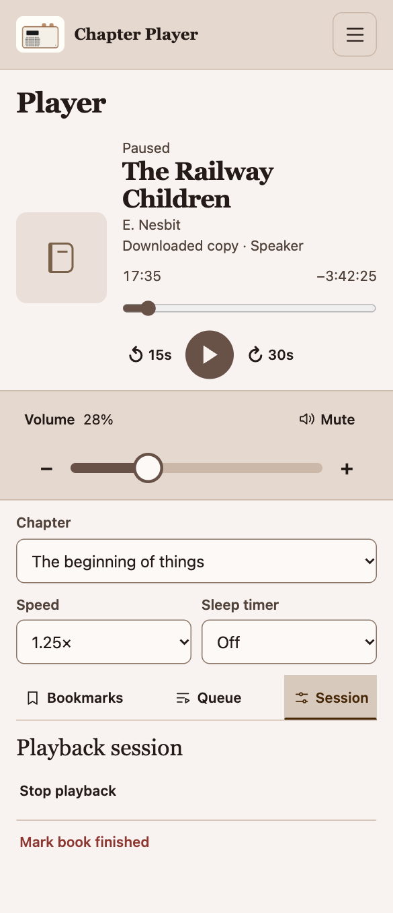

# Listening on Chapter

Start here once your library appears on the player. The two knobs and the web interface control the same book. Sound comes from Chapter’s speaker or the Bluetooth speaker connected to it. On a phone, use the three-line **Main menu** at the top right to change pages.

## Find a book with the Select knob

Turn **Select** to move through books. To reach **Browse library** quickly, turn back one step from the first book. Click to enter, turn to a choice and click again. **Back** takes you up one level.

| Choose | What happens |
| --- | --- |
| **Continue Listening** | Opens unfinished books with a saved position, most recently updated first. |
| **Series** | Choose a series to see its books in sequence. Pick a title yourself or choose **Continue series** to resume the most recently updated unfinished book with progress, or start the first unfinished book if none is in progress. |
| **Jump to letter** | Pick a letter and the knob lands on the first matching book in the main list. Turn to browse from there. |
| **Pinned shelf** | Opens the collection or playlist chosen in the browser under **Settings → Books → Choose a pinned shelf**. |
| **Downloaded** | Lists completed copies on the Pi. Choosing a book here uses its local audio. |
| **Podcasts** | Choose a show, then an episode. To add an RSS feed or Apple Podcasts show link, open **Podcasts** in the browser and choose **Save Podcasts**. |

To change the main list, open **Settings → Books → Library order** in the browser. Choose **Title**, **Author (first name)** or **Author (last name)**, then **Save book settings**. Author order keeps books in a series together and uses their sequence. **Jump to letter** follows the chosen order.

## Find a book from your phone

Open **Library**. Use **Browse by** for series, authors, collections, playlists and other shelves. Open a group to see the books inside. Type in **Search**, or select **Downloaded only**, **Hide downloaded** or **Hide finished**. Results update as you go. Use the page numbers and arrows below the books for more results.

The centre play button on a cover starts or resumes that title on Chapter. On a computer, hover over the cover or move keyboard focus to its controls. A playing book shows a pause button. The **ⓘ** at the top left opens **Book details**, including the synopsis when available. The arrow at the top right downloads the book to the Pi. [Downloading books for offline use](downloads-and-offline-listening.md)

## While a book is open

On the OLED, turn **Select** across **Home**, **Prev**, **Play** or **Pause**, **Next** and **...**. **Home** lets you browse while listening. **Prev** and **Next** ask you to confirm a chapter change. For a short skip within the book, open **...** and choose **Back** or **Forward** with the number of seconds shown.

In the browser, open **Player** while a book is opening, playing or paused. Under the title you can see **Streaming** or **Downloaded copy**. Drag the listening position to seek, use the skip buttons for short jumps, and use the volume slider or **−** and **+** for one percentage point at a time.

| I want to… | On Chapter | In the browser |
| --- | --- | --- |
| Cancel an accidental selection | Click **Select** while the book is opening. | Press **×** on the cover or **Player → Cancel opening**. |
| Pause and resume | Choose **Pause**, then **Play** to continue. | Press the centre pause or play button. |
| Jump to a chapter | **... → Choose chapter** | Use the **Chapter** selector when the book has chapter markers. |
| Save or revisit a passage | **... → Save bookmark** or **Bookmarks** | **Player → Bookmarks → Save bookmark**, or choose a saved place. Audiobookshelf bookmarks need a server connection. |
| Undo a jump | **... → Undo last jump** when offered | **Player → Bookmarks → Undo last jump** |
| Stop and save my place | **... → Stop playback** | **Player → Session → Stop playback** |
| Mark the book as read | **... → Mark finished** and confirm | **Player → Session → Mark book finished** and confirm |

*The mobile Player with an example book. Open Session to close the book and keep your place.*

If the Pi starts up offering the last book, **Continue** starts up to ten seconds before the saved position so you can hear the last phrase again. Choose **Home** to browse instead.

For the current book, choose **Player → Speed**. The five speeds are **1×, 1.25×, 1.5×, 1.75× and 2×**. Under **Settings → Books → Playback speed**, you can save the speed to use when opening books.

### Choose what plays next

In **Library**, open a book’s **ⓘ → Add to listening queue**. To see the order, open **Library → Listening queue** or **Player → Queue**. Use **Move up**, **Move down**, **Remove** or **Play now**. When a book finishes naturally, Chapter can play the next available queued title, then look in the series if the queue offers none. To enable this, tick **Automatically play the next queued or series book** and choose **Save auto-advance**. It starts off. The download queue in **Downloads** is for copying audio to the Pi.

## Listen at night

| What you want | Where to set it |
| --- | --- |
| Pause this book at bedtime | On the OLED choose **... → Sleep timer**, or open **Player → Sleep timer**. In the browser choose **15 min**, **30 min** or **End of chapter** when a chapter marker is available. **Off** clears the timer. |
| Ask periodically whether to keep listening | **Settings → Listening and Night mode → Ask whether to keep listening**. Set the minutes of listening between prompts. |
| Limit volume and dim the OLED at night | **Settings → Listening and Night mode**. Choose **Automatic** and set the start and end times, or **On** to use the limits now. |
| Use a dim clock | **Settings → Display**. Choose **Digital clock**, a 12- or 24-hour format and a dim level. **5%** is the darkest screen saver setting. |
| Switch off the panel while audio continues | **Settings → Display → OLED burn-in protection**. Set an idle timeout, a pair of times, or both. Save the display settings. Times follow the Pi’s clock. Press or turn either knob once to wake it. During scheduled hours it stays awake for one minute after the last dial input. |

## Use a Bluetooth speaker

1. Turn on the speaker. For a new speaker, put it into pairing mode. On Chapter, hold **Select** for three seconds. Opening Bluetooth pauses playback.
2. If Bluetooth is off, choose **Enable**. Open **Speakers**. Names appear as Chapter finds them. Choose the name under **Pair speaker** for a new speaker or **Reconnect** for a saved one.
3. If a step fails, the heading names the failed step. Wake the speaker or disconnect it from its other player, then choose **Retry**. Use **Search again** to repeat discovery.
4. Hold **Select** for three seconds to return to Library. Resume the book. To return to the built-in speaker, select the connected speaker’s name under **Disconnect**. Its pairing is saved.

For a route check, stop the book, unmute Chapter and open **Connections → Check output and test sound**. Choose **Test speaker** or **Test Bluetooth** to hear a short chime. Chapter remembers volume separately for the built-in speaker and Bluetooth output, and restores the saved volume after reboot. **Settings → Sound and feedback** has separate controls for knob clicks and spoken menus.

## Manage the player

- **Library contents.** Open **Settings → Books → Audiobookshelf library**. Select an accessible library and choose **Use library**. **Refresh library** loads recent changes from Audiobookshelf.
- **Appearance.** In **Settings → Themes** choose a colour palette. The default is **Taupe & Gold**. Use the appearance selector for **System**, **Light** or **Dark**. On a phone, the main menu holds both selectors. These choices are saved in your browser.
- **Owner and visitors.** Open **Settings → Security** to require an owner login and choose which pages visitors may read. The separate Audiobookshelf account in **Connections** determines which books the appliance can access. [Owner access and recovery](raspberry-pi-zero-2w-install.md#owner-access-and-password-recovery)
- **Status and support.** Under **System → System status and diagnostics** you can check the installed build, recent playback starts, free space and pending progress updates. Choose **Download diagnostics (JSON)** to save the report. For a copy of your preferences, use **System → Download settings backup**. [Back up and restore settings](raspberry-pi-zero-2w-install.md#back-up-and-restore-settings)
